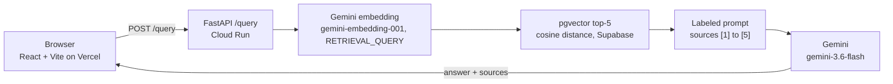

# opt-rag

RAG question answering over 8 CFR 214.2(f), the F-1 student regulation, built to be evaluated.

Live demo: https://opt-rag.vercel.app

The backend scales to zero: first request ~4.9 s, then ~0.2 s (measured on `GET /health`; [DECISIONS.md, Step 12](DECISIONS.md#2026-10-26-step-12-deploy)). A warm `/query` takes 4-5 s, mostly Gemini generation (same entry).

## Results

I ran my 41-question gold set through opt-rag and through bare Gemini, 3 runs each. The headline:

- opt-rag cited no paragraph that does not exist: 0 unknown citations vs 6% for bare Gemini ([summary.md](evals/results/baseline-v1/summary.md)).
- On questions the corpus cannot answer, opt-rag refused 8.3 of 10 vs 3 of 10 for bare Gemini (summary.md).
- opt-rag loses on answer correctness: 0.757 vs 0.840 for bare Gemini (summary.md).

| Metric | opt-rag | bare Gemini |
|---|---|---|
| Answer correctness (reference-claim recall), higher is better | 0.757 (0.739-0.778) | 0.840 (0.808-0.856) |
| Citation accuracy, higher is better | 0.461 (0.453-0.465) | 0.548 (0.501-0.575) |
| Unknown citation rate, lower is better | 0.000 (0.000-0.000) | 0.060 (0.048-0.070) |
| Refuse items judged REFUSED, higher is better | 0.833 (8/10-9/10) | 0.300 (3/10-3/10) |
| False refusal rate on answer items, lower is better | 0.075 (1/31-3/31) | 0.000 (0/31-0/31) |
| Pair stability, higher is better | 0.933 (4/5-5/5) | 1.000 (5/5-5/5) |

Mean over 3 runs, with the min-max across runs in parentheses. Source: [evals/results/baseline-v1/summary.md](evals/results/baseline-v1/summary.md), lines 17 and 22-28 for opt-rag, lines 47-54 for bare Gemini.

| Retrieval and grounding (opt-rag only) | opt-rag |
|---|---|
| Faithfulness | 0.903 (0.894-0.920) |
| Context recall | 0.875 (0.855-0.903) |
| hit@5 | 0.871 (0.871-0.871) |
| MRR | 0.578 (0.578-0.578) |

Source: [summary.md](evals/results/baseline-v1/summary.md), lines 18-21. Bare Gemini retrieves nothing, so these do not apply to it.

## Architecture



## How it works

- Corpus: 8 CFR 214.2(f) from the eCFR API at issue date 2026-09-14, plus 13 Study in the States pages ([data/raw/manifest.json](data/raw/manifest.json)). Raw files and their hashes are committed.
- Chunking follows the document's own structure. Each regulation paragraph is one chunk, and its paragraph ID, such as (f)(10)(ii)(E), is the citation key. Study in the States pages split on headings.
- Embedding: `gemini-embedding-001` truncated to 768 dims ([summary.md](evals/results/baseline-v1/summary.md), line 4), stored in Supabase pgvector. A question gets the top 5 chunks by cosine distance (`RETRIEVAL_TOP_K` in [.env.example](.env.example)).
- Generation: `gemini-3.6-flash` (summary.md, line 3) sees the chunks labeled [1] to [5]. The prompt requires a citation for every claim, a refusal when the sources lack the answer, a fixed not-legal-advice line, and English only.
- The page renders the answer as markdown and marks each source as cited or retrieved, not cited.

## Stack

Python 3.12, FastAPI, Supabase pgvector, Gemini (embedding and generation), Ragas, React + Vite + TypeScript, Cloud Run, Vercel.

## Run locally

You need uv, Docker, the Supabase CLI, Node.js, and a Gemini API key.

```sh
uv sync --frozen --group dev --group eval
cp .env.example .env              # then set GEMINI_API_KEY
supabase start                    # local Postgres + pgvector, applies supabase/migrations
uv run python scripts/ingest.py   # chunk, embed, and store the corpus in local Supabase
```

Start the API. It reads `DATABASE_URL` from the process environment only.

```sh
export DATABASE_URL="$(supabase status -o env | sed -n 's/^DB_URL="\(.*\)"$/\1/p')"
uv run uvicorn app.main:app --port 8000
```

In a second terminal, start the frontend. It calls `VITE_API_URL`, which defaults to `http://localhost:8000`. The API allows the origins in `CORS_ALLOWED_ORIGINS`, which `.env.example` sets to `http://localhost:5173`.

```sh
cd frontend && npm install && npm run dev
```

## Design decisions

Every design decision, with the alternatives I rejected, is in [DECISIONS.md](DECISIONS.md).

- [Chunk on the regulation's paragraph structure](DECISIONS.md#2026-09-01-chunking-strategy), so every chunk carries a real citation key.
- [Compare against bare Gemini with retrieval as the only difference](DECISIONS.md#2026-10-08-baseline-comparison-bare-gemini-vs-opt-rag), to test whether RAG helps on public data at all.

## Disclaimer

opt-rag summarizes public regulations for information only. It is not legal advice. Check with your DSO or an immigration attorney before you act on any answer.
