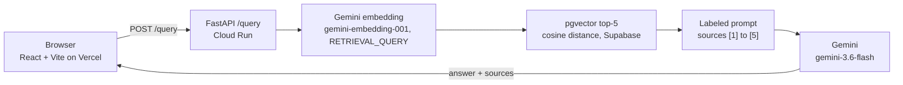

# opt-rag

RAG question answering over 8 CFR 214.2(f), the F-1 student regulation, built to be evaluated.

Live demo: https://opt-rag.vercel.app

The backend scales to zero: first request ~4.9 s, then ~0.2 s (measured on `GET /health`; [DECISIONS.md, Step 12](DECISIONS.md#2026-10-26-step-12-deploy)). A warm `/query` takes 4-5 s, mostly Gemini generation (same entry).

## Results

I ran my 41-question gold set through opt-rag and through bare Gemini, 3 runs each. The headline:

- opt-rag cited no paragraph that does not exist: 0 unknown citations vs 6% for bare Gemini ([summary.md](evals/results/baseline-v1/summary.md)).
- On questions the corpus cannot answer, opt-rag refused 8.3 of 10 vs 3 of 10 for bare Gemini (summary.md).
- opt-rag loses on answer correctness: 0.757 vs 0.840 for bare Gemini (summary.md).

| Metric | opt-rag | bare Gemini |
|---|---|---|
| Answer correctness (reference-claim recall), higher is better | 0.757 (0.739-0.778) | 0.840 (0.808-0.856) |
| Citation accuracy, higher is better | 0.461 (0.453-0.465) | 0.548 (0.501-0.575) |
| Unknown citation rate, lower is better | 0.000 (0.000-0.000) | 0.060 (0.048-0.070) |
| Refuse items judged REFUSED, higher is better | 0.833 (8/10-9/10) | 0.300 (3/10-3/10) |
| False refusal rate on answer items, lower is better | 0.075 (1/31-3/31) | 0.000 (0/31-0/31) |
| Pair stability, higher is better | 0.933 (4/5-5/5) | 1.000 (5/5-5/5) |

Mean over 3 runs, with the min-max across runs in parentheses. Source: [evals/results/baseline-v1/summary.md](evals/results/baseline-v1/summary.md), lines 17 and 22-28 for opt-rag, lines 47-54 for bare Gemini.

| Retrieval and grounding (opt-rag only) | opt-rag |
|---|---|
| Faithfulness | 0.903 (0.894-0.920) |
| Context recall | 0.875 (0.855-0.903) |
| hit@5 | 0.871 (0.871-0.871) |
| MRR | 0.578 (0.578-0.578) |

Source: [summary.md](evals/results/baseline-v1/summary.md), lines 18-21. Bare Gemini retrieves nothing, so these do not apply to it.

Bare Gemini scores higher on correctness because 8 CFR 214.2(f) is public and well covered in its training data ([DECISIONS.md](DECISIONS.md#2026-10-24-step-10-baseline-v1-results-and-failure-analysis)). opt-rag has zero unknown citations against 6% (0.060) for bare Gemini (summary.md). opt-rag refuses 8.3 of 10 refuse items on average (0.833), bare Gemini 3 of 10 (0.300) (summary.md).

## Architecture



## How it works

- Corpus: 8 CFR 214.2(f) from the eCFR API at issue date 2026-09-14, plus 13 Study in the States pages ([data/raw/manifest.json](data/raw/manifest.json)). Raw files and their hashes are committed.
- Chunking follows the document's own structure. Each regulation paragraph is one chunk, and its paragraph ID, such as (f)(10)(ii)(E), is the citation key. Study in the States pages split on headings.
- Embedding: `gemini-embedding-001` truncated to 768 dims ([summary.md](evals/results/baseline-v1/summary.md), line 4), stored in Supabase pgvector. A question gets the top 5 chunks by cosine distance (`RETRIEVAL_TOP_K` in [.env.example](.env.example)).
- Generation: `gemini-3.6-flash` (summary.md, line 3) sees the chunks labeled [1] to [5]. The prompt requires a citation for every claim, a refusal when the sources lack the answer, a fixed not-legal-advice line, and English only.
- The page renders the answer as markdown and marks each source as cited or retrieved, not cited.

## Eval method

- Gold set v1: 41 questions I wrote by hand, seeded from OPT questions my classmates and I actually asked. 31 are answer items and 10 are refuse items. The set includes 5 pairs that ask the same thing neutrally and with a leading preference ([evals/README.md](evals/README.md)).
- An LLM drafted the reference answers. Codex cross-checked them against the corpus, and I reviewed each one ([DECISIONS.md](DECISIONS.md#2026-10-23-gold-set-v1-frozen)). The file is hash-frozen; any change voids the baseline.
- Two arms with the same generation model. opt-rag answers from the retrieved sources. Bare Gemini answers from its own knowledge, with the same citation, refusal, and disclaimer rules ([DECISIONS.md](DECISIONS.md#2026-10-24-step-10-bare-arm-prompt-factualcorrectness-mode-smoke-scope)).
- Judge: gpt-5.4 ([summary.md](evals/results/baseline-v1/summary.md), line 5), from a different vendor than the generator. 3 runs per arm (summary.md, line 11).
- Citation accuracy, unknown citation rate, hit@5, and MRR are computed in code, with no judge.
- Human check: I hand-scored 10 items and agreed with the judge on 7/10 ([human_check.md](evals/results/baseline-v1/human_check.md), line 213).
- Failure analysis of the 5 worst opt-rag items: dataset 2 (Q8, Q9), retrieval 1 (the P05 pair), generation 1 (Q23) ([DECISIONS.md](DECISIONS.md#2026-10-24-step-10-baseline-v1-results-and-failure-analysis)). Gold v1 stays frozen. The dataset fixes go into a gold v2.

## Run locally

You need uv, Docker, the Supabase CLI, Node.js, and a Gemini API key. Rerunning the eval also needs an OpenAI API key.

```sh
uv sync --frozen --group dev --group eval
cp .env.example .env              # then set GEMINI_API_KEY
supabase start                    # local Postgres + pgvector, applies supabase/migrations
uv run python scripts/ingest.py   # chunk, embed, and store the corpus in local Supabase
```

Start the API. It reads `DATABASE_URL` from the process environment only.

```sh
export DATABASE_URL="$(supabase status -o env | sed -n 's/^DB_URL="\(.*\)"$/\1/p')"
uv run uvicorn app.main:app --port 8000
```

In a second terminal:

```sh
curl -s -X POST localhost:8000/query -H 'Content-Type: application/json' \
  -d '{"question": "How many days of unemployment are allowed on post-completion OPT?"}'
```

Start the frontend. It calls `VITE_API_URL`, which defaults to `http://localhost:8000`. The API allows the origins in `CORS_ALLOWED_ORIGINS`, which `.env.example` sets to `http://localhost:5173`.

```sh
cd frontend
npm install
npm run dev                       # http://localhost:5173
```

Run the tests. The backend suite needs local Supabase running; the frontend suite mocks fetch. The backend suite resets the local Supabase database (supabase db reset in conftest). Run scripts/ingest.py again before manual /query calls.

```sh
uv run pytest
cd frontend && npm test
```

Rebuild the baseline summary from the committed results. This makes no API calls.

```sh
uv run --group eval python scripts/eval.py summary --run-id baseline-v1
```

A new eval run calls Gemini and the judge for every item. The baseline's judge calls cost USD 3.36 ([DECISIONS.md](DECISIONS.md#2026-10-24-step-10-baseline-v1-results-and-failure-analysis)).

```sh
uv run --group eval python scripts/eval.py run --arm both --runs 3 --run-id <new-run-id>
```

## Deploy

- Backend: Google Cloud Run in us-east1, max-instances 1, concurrency 10, min-instances 0 ([deploy/cloudrun.sh](deploy/cloudrun.sh)). The caps are a spend limit. `/query` is public and has no rate limit.
- Secrets: `GEMINI_API_KEY` and `DATABASE_URL` live in Secret Manager and are mounted at deploy time (deploy/cloudrun.sh).
- Image: `python:3.12.14-slim` with uv 0.12.9, the version that wrote `uv.lock` ([Dockerfile](Dockerfile)). Runtime dependencies only. 368 MB ([DECISIONS.md, Step 12](DECISIONS.md#2026-10-26-step-12-deploy)).
- Frontend: Vercel, root directory `frontend/`, `VITE_API_URL` set at build time.

```sh
GCP_PROJECT=<project-id> deploy/cloudrun.sh
```

The full runbook, including one-time setup and secrets, is in [deploy/README.md](deploy/README.md).

## Design decisions

- [Chunk on the regulation's paragraph structure](DECISIONS.md#2026-09-01-chunking-strategy), so every chunk carries a real citation key.
- [Labeled sources, mandatory citations, and a refusal rule in the prompt](DECISIONS.md#2026-09-01-generation-prompt-structure), so errors can be traced to retrieval or generation.
- [Compare against bare Gemini with retrieval as the only difference](DECISIONS.md#2026-10-08-baseline-comparison-bare-gemini-vs-opt-rag), to test whether RAG helps on public data at all.
- [Freeze the gold set by hash](DECISIONS.md#2026-10-23-gold-set-v1-frozen), so a baseline cannot drift.
- [Judge with another vendor's model and score citations in code](DECISIONS.md#2026-10-23-step-10-judge-model-and-custom-metrics), to avoid self-preference bias.

## Limitations and v2 backlog

Limitations:

- The corpus is pinned to eCFR issue date 2026-09-14, the last version before the DHS Duration of Status rule's text entered the eCFR. That rule is enjoined; the 2026-10-01 snapshot carried its 30-day grace period and OPT filing-window text, which conflicts with the 60 days on Study in the States ([DECISIONS.md](DECISIONS.md#2026-10-22-tier-1-re-pinned-to-ecfr-issue-date-2026-09-14)).
- opt-rag wrongly refused 1 to 3 of 31 answerable questions per run (summary.md, line 27). These false refusals account for most of the correctness gap (DECISIONS.md).
- The judge is not deterministic. It scored one identical answer 0.00 in one run and 1.00 in the other two (human_check.md).
- Refusal is prompt-only. The API has no refused field, so the page shows a refusal as a normal answer.
- Some answers live in SEVP policy guidance, which is not in the corpus (evals/README.md).
- English only.

v2 backlog ([DECISIONS.md](DECISIONS.md#2026-10-13-v2-backlog)), each run as a one-variable experiment against baseline-v1:

- Gold v2 with the dataset fixes from the failure analysis.
- Refusal experiments, starting with the false refusals.
- Hybrid search, reranking, and chunking experiments.
- SEVP policy guidance in the corpus.
- Langfuse tracing.
- A newer Gemini Flash generation model.
- Deploy hardening: a dedicated service account, rate limiting on `/query`, and a database connection pool ([DECISIONS.md, Step 12](DECISIONS.md#2026-10-26-step-12-deploy)).

## Disclaimer

opt-rag summarizes public regulations for information only. It is not legal advice. Check with your DSO or an immigration attorney before you act on any answer.
